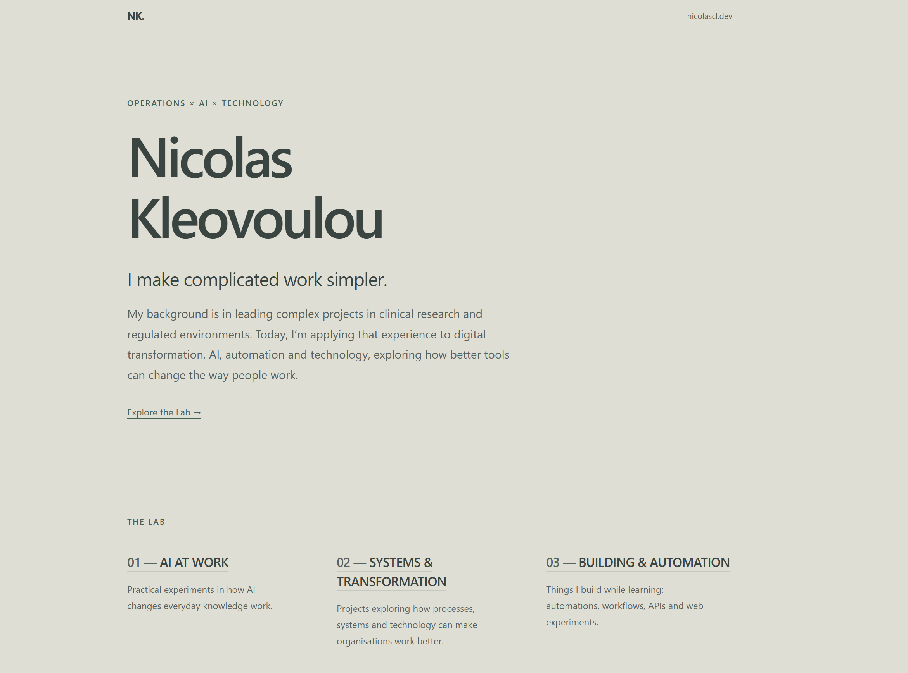

Programming, coding and I have a classic love-hate relationship.

While still at school, I took Computer Science GCE A Level - ***yes I am this old*** - and I was infatuated by the subject. I spent hours and hours on *Microsoft Access* creating my DVD Club project. When my teacher called me with my grade, she said that I got a straight A and also that I came first in Cyprus that year. She told me I should consider pursuing a degree in computer science. So I did the right thing for an 18-year-old. I ignored her advice and studied something that would provide me with much more lucrative employment opportunities. ***Biology***. The programming itch came back soon after I finished my master's degree. You guessed it. Also in Biology. I was convinced this was my calling. Throughout the years I learned a lot in my free time. I learned alone, typing away on my keyboard, but I also suffered from impostor syndrome, and so I have nothing to show for it. This website is the first project allowed outside my personal web browser.

## How the site came together

“I built my website with AI” can sound like “I am good at prompting” or prompt engineering - whatever you want to call it. I prefer, however, to describe it like this:

As a project manager, I worked with a couple of tools, camouflaged as professionals in their fields. The tools used were Codex and Claude Code acting as my engineers. I am acting as the product manager and I also act as the lead UI/UX designer. I also have a senior designer on my team. Her name is Adobe Creative Cloud. The skills that made it work were the ones I use every day as a project lead.

The very first draft - which was never published - was done using OpenAI's GPTSites feature. Using this feature, I used a well-structured, simple prompt and the result was a similarly simple, static homepage with basic information about what the website is, who I am and what I do.

Following the first team sprint, a simple web inspector revealed a **gigantic** HTML soup document with inline CSS and JavaScript. GPTSites was given the freedom to decide on styling, colour palettes and fonts. You will see from the screenshot below, GPTSites' most mastered skill is not styling. I have no idea what was the chain of thought that led it to believe that a military-styled branding was the way to go.

Using what little coding skills I have, I went into a rabbit hole quest of creating three separate files out of the soup: an HTML, a CSS and a JS file. It was a hideous process, as you can imagine. But from then on I was able to have full visibility of what was behind a website initially created using a single prompt. I was then able to get more involved in the programming parts of the project with Codex and Claude Code. They can confirm that I am **NOT** a micromanager.

## The Random Google Developer Course

You will see in upcoming posts that I am a volunteer for an amazing bunch of people at the [Google Developer Group Cyprus](https://gdg.community.dev/gdg-cyprus/). Check us out. We spent the month of October preparing for GDG Cyprus DevFest 2026, which took place on October 31st, 2026. The impostor syndrome kicks in again and I find myself taking random courses because all the other volunteers are obviously developers. [Grounded Agents with Firebase SQL Connect](https://developers.google.com/solutions/learn/data-connect-grounded-agents) was the course of choice. Don't ask me why.

Nevertheless, finishing that course introduced me to a number of technologies including Firebase, Firebase SQL Connect, Vertex AI and Next.js. One of them was utilised in making this website possible. Firebase Hosting is what I am using to host. I am also using one of the thousands of domains I bought and immediately parked over my programming itch years for no reason at all. That would be [nicolascl.dev](https://nicolascl.dev).

## Git, GitHub and a Pipeline I Didn't Know I Had

What kind of biologist pretending to understand code wouldn't use Git and GitHub? I learned both years ago and never used them. It turns out I already knew the idea, just under a different name.

In my neck of the woods, every piece of work goes through extensive rounds of fuming back and forths, usually with your manager. Redline is everywhere and comments in tracked changes like "Please remove that semicolon" make you want to scratch your very own eyes out. Git does the same. But for code. GitHub is the SharePoint or OneDrive where your work is placed, so you can pretend you are working at your desk while you are with your laptop (literally) by the pool. We say Draft V0.1 and Final Version 1.0. Code people say Pull Request and Main Branch.

The second part took me longer to understand. Every time Codex or Claude Code implements a change after an infuriating back and forth (remember, I am the product manager), the site checks it automatically and Firebase gives me a link to review. When I like it, and I usually do, I **merge** to the main branch and that's it. Goes live. Code people call this CI/CD: continuous integration and continuous delivery.

This post went through exactly that process. You are reading the version that passed.
And I hope you enjoyed it. Look out for the next ones.

Nicolas Cl
